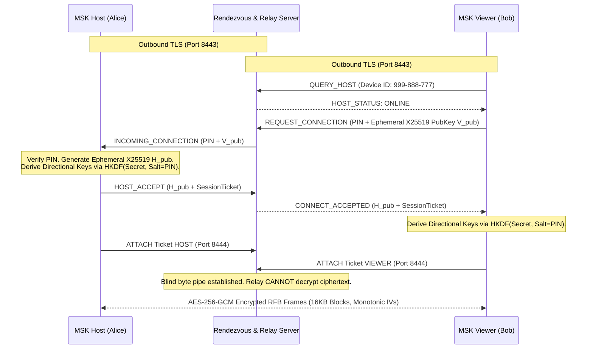

# MSK Remote (VNC Remote Connect)

[](https://www.gnu.org/licenses/old-licenses/gpl-2.0.en.html)
[](https://microsoft.com/windows)
[]()
[-indigo.svg)]()

> **High-speed, end-to-end encrypted remote desktop control for Windows.**  
> Powered by the **TightVNC 2.8.90** engine, modern **X25519 + AES-256-GCM** authenticated encryption, and a **zero-knowledge TLS relay** that effortlessly traverses campus firewalls, CGNAT, and college Wi-Fi networks without requiring port forwarding.

---

## 🌟 Highlights

- **🔒 Authenticated End-to-End Encryption (E2EE):** Ephemeral X25519 Elliptic-Curve Diffie-Hellman key exchange, SHA-256 HKDF directional key derivation, and AES-256-GCM AEAD encryption. The relay operator or campus network eavesdropper cannot see your screen or keystrokes.
- **🌐 Seamless NAT & Firewall Traversal:** Both host and viewer establish standard outbound TLS connections on ports 8443 and 8444. Works cleanly across college Wi-Fi, cellular hotspots, and restrictive routers.
- **⚡ Ultra-Lightweight Native Windows GUI:** Built with native WPF and hardware-accelerated DirectX rendering. Executable size is only **37 KB** with sub-second launch times (no Electron bloat).
- **🛡️ Secure Reverse Loopback Bridge:** Keeps TightVNC Server strictly isolated from the external network and uses TightVNC's reverse loopback connection (`tvnserver -controlservice -connect`), bypassing administrative loopback registry blocks without opening inbound ports.
- **📦 Zero-Setup Portable Releases:** Available as a 0.95 MB lightweight zip and a 32 MB standalone self-contained distribution with portable runtime included.

---

## 🚀 Quick Start & How to Test

### 1. Launching the App
Simply run the included root launcher:
```powershell
.\Launch-MSKRemote.bat
```
or open:
```
dist\MSK-Remote\MSKRemote.exe
```

---

### 2. How to Share Your Screen (Host)
1. In the MSK Remote window, select the **💻 Share Screen (Host)** tab.
2. Click **🟢 Start Sharing (Allow Connections)**.
3. The app connects to the relay and generates:
   - **Your Device ID** (e.g., `888-123-456`)
   - **One-Time Session PIN** (e.g., `582910`)
4. Share the Device ID and PIN with the person connecting to you.

---

### 3. How to Connect to a Remote PC (Viewer)
1. Open MSK Remote and select the **🔗 Connect to Remote (Viewer)** tab.
2. Enter your partner's **Device ID** and **Session PIN**.
3. Choose your connection profile:
   - **⚡ Fast (Optimized for College Wi-Fi / Low Bandwidth):** Tight encoding, level 7, JPEG quality 6.
   - **⚖️ Balanced (Recommended):** Smooth colors and low latency.
   - **💎 Maximum Quality:** Lossless fidelity.
4. Click **🚀 Connect to Remote PC**.
5. Once authenticated, the E2EE tunnel is established and the TightVNC Viewer window launches automatically!

---

### 4. Cross-Network Testing (Home Wi-Fi vs Mobile Hotspot / College Wi-Fi)
To test across separate networks:
1. Connect **PC A (Host)** to your home Wi-Fi.
2. Connect **PC B (Viewer)** to your mobile phone hotspot or college Wi-Fi.
3. On the **⚙️ Relay & Network** tab, ensure the Relay Host points to your accessible relay server IP (or run the built-in relay on a machine with public/accessible IP).
4. Click **⚡ Test Relay Connection (Ping)** to verify latency and TLS handshake.
5. Initiate the connection from PC B to PC A.

---

## 📥 High-Speed Download Packages (Global CDN)

Downloads are hosted on GitHub's global edge CDN for instant, maximum-speed downloads without throttling:

| Package | Size | Download Link | Description |
| :--- | :---: | :---: | :--- |
| **⚡ Lightweight Package** | **0.95 MB** | [⬇️ **Download Lightweight ZIP (0.95 MB)**](https://github.com/vihivincorp/VNCremoteconnect/releases/download/v1.0.0/MSK-Remote-v1.0.0-Lightweight.zip) | **Fastest (< 1 second download).** Ultra-compact package containing native `MSKRemote.exe`, E2EE engine, and TightVNC binaries. |
| **🚀 Standalone Package** | **32.0 MB** | [⬇️ **Download Standalone ZIP (32 MB)**](https://github.com/vihivincorp/VNCremoteconnect/releases/download/v1.0.0/MSK-Remote-v1.0.0-Standalone-with-Runtime.zip) | **Zero prerequisites.** Bundles portable runtime, native UI, and TightVNC. Just unzip and run on any Windows 10/11 machine. |

> 💡 **Tip for Slow Networks / College Wi-Fi:** Choose the **0.95 MB Lightweight Package**. It is under 1 MB and downloads virtually instantaneously even on weak mobile connections.


---

## 🔒 Security Architecture



1. **Zero-Knowledge Relay:** The relay server acts solely as a blind conduit. All payload data passing through ports 8443/8444 is ciphertext authenticated with GCM tags.
2. **Ephemeral Sessions:** Keys are generated uniquely per session using X25519 ECDH. No static shared secrets are stored.
3. **Replay & Reflection Defense:** SHA-256 HKDF derives strictly directional keys (`sendKey` and `recvKey`), ensuring frames from host to viewer cannot be reflected back.

---

## 🛠️ Building From Source

You do not need Visual Studio installed. MSK Remote compiles using the built-in Windows .NET Framework compiler `csc.exe`:

```powershell
cd msk-remote-app
.\build.bat
```

To create both release zip archives:
```powershell
cd msk-remote-app
powershell -ExecutionPolicy Bypass -File package.ps1
```

---

## 📜 Licensing & Upstream Attribution

- **TightVNC:** MSK Remote redistributes and interfaces with components of **TightVNC 2.8.90**, licensed under the **GNU General Public License v2 (GPL v2)**.
- Upstream Copyright © 1999–2024 GlavSoft LLC and original TightVNC contributors.
- The complete upstream GPL source archive is included in [`tightvnc-2.8.90-src-gpl.zip`](tightvnc-2.8.90-src-gpl.zip) and extracted in [`tightvnc-2.8.90-gpl/`](tightvnc-2.8.90-gpl/) in compliance with GPL v2 Section 3.
- Full license terms are documented in [`GPL-LICENSE.txt`](dist/MSK-Remote/GPL-LICENSE.txt).
